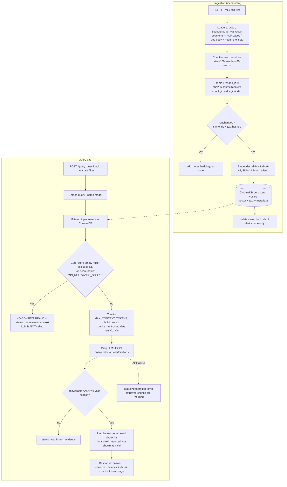

# Architecture

## Flow (matches template section 1.1)

## Modules

| Package | Responsibility |
|---|---|
| `app/config.py` | env-based settings, validation, secret-safe repr |
| `app/ingestion/` | `loaders` (PDF/HTML/MD), `chunking`, `hashing` (stable ids), `pipeline` (idempotent upsert/prune) |
| `app/embeddings/` | `Encoder` ABC; MiniLM backend; offline `hash` fallback |
| `app/vectorstore/` | `ChromaStore` wrapper, `filters` (validated metadata filters) |
| `app/retrieval/` | `Retriever` (timed, LLM-free), `relevance` (abstention gate) |
| `app/generation/` | `prompts`, `groq_client` (bounded retries, categorised errors), `citations`, `answer_service` (statuses) |
| `app/api/`, `app/main.py` | FastAPI routes, error handlers, app factory |
| `app/evaluation/` | dataset, metrics, judge, calibration, latency, cost model, harness |

## Statuses (never conflated)
`answered` - `no_relevant_context` (retrieval gate, LLM not called) - `insufficient_evidence` (LLM called, evidence lacking or no valid citation) - `generation_error` (retrieval ok, LLM failed).

## Persistence and concurrency
ChromaDB `PersistentClient` (SQLite + HNSW files) in `CHROMA_PERSIST_DIRECTORY`. Run **one** server process per directory; multiple writers are not supported. Back up by stopping the service and copying the directory. The collection records the embedding model/dimension and the app refuses to open it with a different model (it never silently resets).
